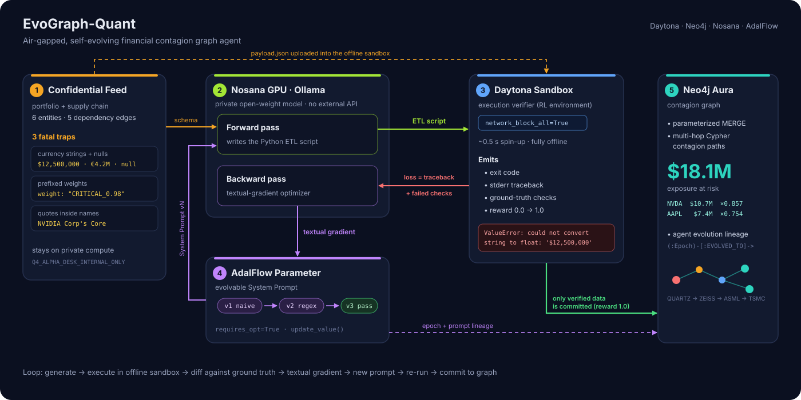

<p align="center">
  
</p>

# EvoGraph-Quant

**A self-healing ETL agent for confidential financial graphs.** It writes its own data-cleaning code, runs that code in an offline **Daytona** sandbox, learns from the real traceback, rewrites its own prompt, and loads only verified data into a **Neo4j** supply-chain risk graph. The model runs on private **Nosana** GPUs.

> Built at the Daytona Hackathon (Singapore). Sponsors used: **Daytona** (execution verifier), **Neo4j** (contagion graph + agent lineage), **Nosana** (private LLM inference).

---

## The problem

Quant desks and risk teams want to merge **confidential portfolio holdings** with **alternative supply-chain intel** into a graph. With that graph they can answer questions like *"if a sole-source raw material fails, which of my positions get hit, and how much money is at risk?"*

Two things stop them:

1. **They can't send the data to a closed external agent.** Positions are confidential, so the model has to run on compute they control.
2. **Small private models write fragile ETL code.** Real feeds are dirty: amounts like `"$12,500,000"`, `"€4.2M"` and `null`, weights like `"CRITICAL_0.98"`, and names with apostrophes such as `NVIDIA Corp's Core`. The generated script crashes. Or worse, it "succeeds" and silently writes wrong numbers into the risk graph.

Today a human babysits every one of these scripts. EvoGraph-Quant closes the loop instead: **failing → diagnosing → fixing → verifying** runs automatically. Nothing reaches the graph until an independent checker agrees with the result.

## How it works

<p align="center">
  
</p>

1. **Forward pass (Nosana).** A small open model on a Nosana GPU reads the current *system prompt*, which is a trainable AdalFlow `Parameter`, and writes a stdlib-only Python ETL script.
2. **Execution verifier (Daytona).** The script runs in a fresh Daytona sandbox with **all outbound network blocked**. The confidential payload is uploaded as `payload.json`; it never appears inside the generated code. We capture the real `exit_code` and stdout/traceback.
3. **Independent reward.** `ground_truth_checker.py` parses the script's `CLEANED_GRAPH_JSON:` line and compares every node and edge against ground truth: exposure within 1%, weight within 0.005, names byte-exact including apostrophes, and the correct currency. The script printing "passed" doesn't count. The checker decides. This prevents reward hacking such as wrapping everything in `try/except`.
4. **Backward pass (textual gradient).** If the check fails, the optimizer model receives the failed code, the sandbox traceback and the checker's failure list. It gets a **schema hint only, never the raw confidential values**. It returns a diagnosis (the *textual gradient*) and an **updated system prompt**, and `Parameter.update_value()` applies it.
5. **Repeat** until the sandbox run passes. Usually epoch 1 fails and epoch 2 or 3 passes.
6. **Commit to Neo4j (from the host).** Only verified data gets written, using parameterized `UNWIND … MERGE`. A multi-hop Cypher query then computes how risk propagates from the raw-material shock to each portfolio holding. Every epoch and every prompt version is also stored as a lineage graph.

**Demo result:** a force-majeure event at `RAW:QUARTZ_X` (Spruce Pine high-purity quartz) propagates through Zeiss → ASML → TSMC:

| Holding | Path contagion (∏ weights) | Exposure | At risk |
|---|---|---|---|
| `HOLDING:NVDA` | 0.98 × 0.95 × 0.92 × 1.0 = **0.8565** | $12.5M | **≈ $10.71M** |
| `HOLDING:AAPL` | 0.98 × 0.95 × 0.92 × 0.88 = **0.7537** | $9.8M | **≈ $7.39M** |

### Measured tonight

| What | Result |
|---|---|
| **Golden run** (`replay/golden_run.json`): real Nosana + Daytona + Neo4j | **35 s** end to end. Epoch 1 forward 4.8 s; sandbox `exit=1`, `ValueError: could not convert string to float: '1.5M'`, reward 0.0. Gradient 8.3 s. Epoch 2 forward 10.7 s; sandbox passes, reward **1.0**. Neo4j commit: 6 nodes, 5 relationships. NVDA $10,706,500, AAPL $7,386,628 (≈ **$18.1M**). |
| **Scripted run** (`replay/scripted_run.json`): real Daytona + Neo4j, pre-written LLM text | 3 epochs, reward **0.0 → 0.733 → 1.0**. The partial script missed the `M` multiplier, and the checker caught it. |
| **Nosana inference**: `qwen3.8:27b` on an RTX 5090 (32 GB), thinking off | Forward: a 101-line script, 836 tokens, **5.4 s**. Backward: a JSON prompt rewrite, **5.1 s**. Two concurrent calls queue (11.2 s total) and don't deadlock. |
| **Prompt lab** (`docs/PROMPT_LAB.md`): Nosana `qwen3.8:27b` + real offline Daytona | NAIVE prompt **0/5** pass. All 5 runs exit 1 with `ValueError: could not convert string to float: '1.5M'`: the model stripped `$`, commas and `USD`, then crashed on `'1.5M EUR'`. One real backward pass (8.9 s, its JSON parsed directly) gives an evolved prompt that passes **5/5**, reward 1.0. The demo loop takes about 28 s, excluding Neo4j. |
| **Daytona fan-out** (`parallel_sandbox.py`) | 6 candidates in 6 offline sandboxes: **4.9 s** wall time vs **21.0 s** serial (**4.3×**). The best candidate (robust, reward 1.0) is selected. |
| **Generalisation** (`docs/GENERALIZATION.md`) | The final scripted-run script on the new EV-battery feed crashes on a new `HIGH_` prefix: reward **0.0**. One extra rule takes it to **0.946**. New dirt becomes the next loss signal. |

---

## How each sponsor is used

### Daytona: the RL execution verifier
- `Daytona(DaytonaConfig(api_key=..., api_url=...))`
- `daytona.create(CreateSandboxFromSnapshotParams(language="python", network_block_all=True))`: an **air-gapped** sandbox created in about 0.5s, warmed up before the demo starts
- `sandbox.fs.upload_file(payload_bytes, "payload.json")`: the confidential feed goes into the sandbox, not into the prompt or the code
- `sandbox.process.code_run(code)` → `ExecuteResponse.exit_code` / `.result`: the real runtime signal used as the loss
- `daytona.delete(sandbox)` cleans up at the end of a run
- **Fan-out** (`parallel_sandbox.py`): `verify_many(codes, payload)` runs K candidate scripts in K offline sandboxes at once with a thread pool and keeps the best reward. 6 sandboxes take 4.9 s instead of 21.0 s serial.
- Fallback: if Daytona is unreachable, or `USE_LOCAL_FALLBACK=true`, the same script runs in a local subprocess. The UI then **labels it "Local Fallback"**, so you can always see which engine ran.

### Nosana: private inference
- The forward pass (code) and the backward pass (textual gradient) both run on **`qwen3.8:27b` with Ollama on a Nosana RTX 5090 (32 GB)**, with thinking turned off. Each call takes about 5 s.
- **How we reach it.** The job's public Ollama endpoint was broken because the model directory was mounted read-only. Ollama failed creating `manifests-v2`, and that process is PID 1, so it can't be restarted. The GPU itself was fine, so we started a second Ollama in the same container with a writable model dir. We reach it through the **interactive SSH channel Nosana gives every job**: `scripts/nosana_relay.py` serves an OpenAI-compatible `/v1/chat/completions` on `127.0.0.1:11435` and forwards each request through that session. Confidential data only passes through the Nosana node and this machine.
- `llm_client.py` uses the standard `openai` client against `LLM_BASE_URL` (`FORWARD_MODEL`, `BACKWARD_MODEL` in `.env`). The UI labels it **"Nosana (RTX 5090 · qwen3.8:27b)"**.
- **Fallback, clearly labelled.** If Nosana errors or times out, `llm_client.py` switches to `FALLBACK_BASE_URL`. That is `agent_api_server.py` on `127.0.0.1:8787`, an OpenAI-compatible stand-in backed by headless Claude Code (`claude -p`: haiku for forward, sonnet for backward). The UI then shows **"Agent API stand-in"**, never Nosana. It is a hosted model, so it exists only to keep the demo alive. `LLM_PREFER=fallback` forces it; `OPENAI_API_KEY` also works as a fallback.

### Neo4j: contagion graph and agent lineage
- **Verified upsert only.** Parameterized `UNWIND $nodes AS n MERGE (e:Entity {id: n.id}) SET e += n` (and the same for relationships). Because values are never interpolated, the apostrophe trap is harmless.
- **Multi-hop contagion query**:
  ```cypher
  MATCH p = (r:Entity {tier:'Tier4_RawMaterial'})-[*1..6]->(h:Entity {tier:'Portfolio_Holding'})
  WITH p, h, reduce(s = 1.0, x IN relationships(p) | s * x.weight) AS contagion
  RETURN [n IN nodes(p) | n.id] AS path, h.id AS holding, contagion, h.exposure * contagion AS at_risk
  ORDER BY at_risk DESC
  ```
- **Self-evolution lineage**: `(:EvoRun)-[:HAS_EPOCH]->(:Epoch)-[:USED_PROMPT]->(:PromptVersion)`. It records each epoch's reward, error summary and textual gradient, so you can see *how* the agent learned. Open `queries.cypher` in Neo4j Browser for ready-made demo queries, load `assets/neo4j_style.grass` to apply the styling, and see `docs/NEO4J_DEMO.md`.

### AdalFlow: trainable prompt parameter
- The system prompt is an `adalflow.optim.parameter.Parameter(data=..., role_desc=..., requires_opt=True)`, and each backward pass calls `update_value()`. `EvoGraphEngine.prompt_versions` keeps the full prompt history for the UI diff and the Neo4j lineage.
- The backward step is a TextGrad-style prompt that we wrote ourselves. It is not AdalFlow's built-in `TGDOptimizer`. We kept it explicit so the demo stays fast and readable.

---

## The 3 data traps (`dirty_payload.py`)

| # | Trap | Example | What naive code does |
|---|---|---|---|
| 1 | **Apostrophes in names** | `NVIDIA Corp's Core`, `Carl Zeiss SMT's Optics`, notes like `'Ultra-Pure'` | Cypher built with f-strings breaks or can be injected. The checker also requires names to match byte-exact, so stripping quotes fails too. |
| 2 | **Mixed currency strings and nulls** | `"$12,500,000"`, `"8500000 USD"`, `"€4.2M"`, `"1.5M EUR"`, `null` | `float()` raises `ValueError` / `TypeError` (verified in a real Daytona sandbox) |
| 3 | **Non-standard weights** | `"CRITICAL_0.98"` mixed with `0.95` | `float()` raises `ValueError` |

The naive starting prompt tells the model to call `float()` directly, so **epoch 1 fails in a real way**. The fix has to be *learned* from the traceback.

---

## Quick start

> AI agents or a fresh machine: see [AGENTS.md](AGENTS.md) for a zero-to-running guide (with and without API keys).
> `scripts/nosana_relay.py` and `agent_api_server.py` are only needed on the demo machine: the relay works around tonight's broken public Ollama endpoint, and the agent API is a labelled stand-in LLM.

```bash
cd EvoGraph-Agent
./setup.sh                          # creates .venv (Python 3.9+), installs pinned deps, import check
cp .env.example .env                # then fill in DAYTONA_API_KEY, LLM_BASE_URL/FORWARD_MODEL/BACKWARD_MODEL, NEO4J_*
source .venv/bin/activate

# LLM endpoints (keep both running during the demo)
python scripts/nosana_relay.py &    # Nosana relay → 127.0.0.1:11435 (first connect ~15 s); then LLM_BASE_URL=http://127.0.0.1:11435/v1
python agent_api_server.py &        # labelled fallback stand-in → 127.0.0.1:8787 (FALLBACK_BASE_URL=http://127.0.0.1:8787/v1)

# Smoke-test each service independently
python scripts/smoke_daytona.py     # create offline sandbox → upload → code_run → delete
python scripts/smoke_llm.py         # Nosana/Ollama /v1 health + model list + one completion
python scripts/smoke_neo4j.py       # Aura connectivity + upsert/contagion round-trip
python -m pytest tests/test_checker.py -q   # ground-truth checker unit tests
python scripts/e2e_scripted.py      # full loop on real Daytona + Neo4j with pre-written LLM steps (~8 s)
python scripts/demo_parallel.py     # Daytona fan-out: 6 candidates in 6 offline sandboxes
python scripts/generalize.py        # final script vs the unseen EV-battery feed (data/)

# Run the dashboard (static web app + stdlib server, no extra deps)
python web_server.py                # http://localhost:8600 — pick a mode in the top bar, click "Run evolution"
# streamlit run app.py              # the older Streamlit dashboard still works

# Headless run + record a replay of a real live run (see `python orchestrator.py --help`)
python orchestrator.py --epochs 3 --record replay/golden_run.json
```

`.env` keys: `DAYTONA_API_KEY`, `DAYTONA_API_URL`, `USE_LOCAL_FALLBACK`, `LLM_API_KEY`, `LLM_BASE_URL`, `FORWARD_MODEL`, `BACKWARD_MODEL`, `NEO4J_URI`, `NEO4J_USER`, `NEO4J_PASSWORD`, `NEO4J_DATABASE` plus the fallback keys `FALLBACK_BASE_URL`, `FALLBACK_API_KEY`, `FALLBACK_FORWARD_MODEL`, `FALLBACK_BACKWARD_MODEL`, and optionally `LLM_PREFER=fallback` or `OPENAI_API_KEY`. Never commit `.env`; it is already in `.gitignore`.

## Run modes (sidebar)

| | **Live (Nosana LLM)** | **Live (real sandbox + scripted LLM)** | **Replay** |
|---|---|---|---|
| LLM code and gradients | Real calls to `qwen3.8:27b` on Nosana; the labelled stand-in is used only if Nosana fails | Pre-written: `reference/` scripts and pre-authored gradients (`scripts/e2e_scripted.py`) | Played back from a recording |
| Daytona sandbox | Real, offline, live | Real, offline, live | Recorded real runs: `golden_run.json` is a full Nosana + Daytona + Neo4j run; `scripted_run.json` has real sandbox and Neo4j steps with pre-written LLM text |
| Neo4j | Real writes and contagion query | Real writes and contagion query | Recorded results |

The primary button is **Run evolution**. The UI always shows the mode, the engine (Daytona or Local Fallback) and the model endpoint (Nosana or the stand-in). Replay exists so a 3-minute stage demo survives bad venue Wi-Fi.

## Project structure

```text
EvoGraph-Agent/
├── CONTRACT.md                # shared module interfaces + event schema
├── dirty_payload.py           # confidential feed with 3 traps, GROUND_TRUTH, schema hint
├── ground_truth_checker.py    # independent reward: parses CLEANED_GRAPH_JSON, checks vs ground truth
├── sandbox_verifier.py        # Daytona sandbox wrapper (offline, warm-up, upload, code_run) + local fallback
├── llm_client.py              # OpenAI-compatible client → Nosana (relay :11435), labelled fallback (:8787)
├── agent_api_server.py        # fallback stand-in: OpenAI-compatible API backed by headless Claude Code
├── parallel_sandbox.py        # Daytona fan-out: K candidates in K offline sandboxes, best-of-K
├── prompts.py                 # naive initial prompt, forward template, backward (textual-gradient) template
├── evo_engine.py              # AdalFlow Parameter, forward codegen, backward textual gradient
├── graph_store.py             # Neo4j: parameterized MERGE, multi-hop contagion, evolution lineage
├── queries.cypher             # demo queries for Neo4j Browser
├── orchestrator.py            # evolution loop as an event stream; replay save/load; CLI
├── web/index.html             # dashboard: provider strip, live loop + console, epoch ledger, animated Neo4j contagion graph, fan-out
├── web_server.py              # stdlib server for web/: replays, SSE live runs, fan-out, Neo4j reset
├── app.py                     # older Streamlit dashboard (kept as a fallback)
├── reference/                 # hand-written naive (fails) + robust (passes) ETL scripts
├── replay/                    # mock_run.json, scripted_run.json, golden_run.json
├── scripts/                   # smoke_*.py, e2e_scripted.py, demo_parallel.py, generalize.py, nosana_relay.py
├── tests/test_checker.py      # checker unit tests
├── data/                      # extra / larger dirty supply-chain scenarios
├── assets/                    # banner, architecture diagram, neo4j_style.grass (Neo4j Browser styling)
└── docs/                      # PITCH.md (3-min demo script), NEO4J_DEMO.md, GENERALIZATION.md, PROMPT_LAB.md
```

## Sandbox script contract

Each generated script must:
- read `payload.json` from its working directory, using only the standard library (`json`, `re`), with no network access
- print exactly one line `CLEANED_GRAPH_JSON: {"nodes":[{"id","name","tier","exposure","currency","status"}],"edges":[{"src","dst","rel","weight"}]}`
- print `ASSERTION_PASSED_GRAPH_COMMITTED` as its last line, and exit non-zero on any error

Even when a script follows all of this, it only gets a reward if `ground_truth_checker.py` agrees with its output.
