<p align="center">
  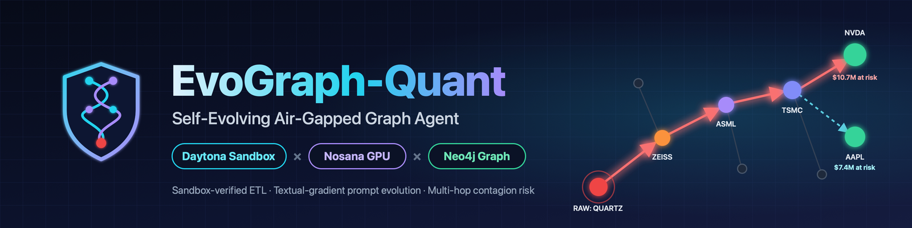
</p>

<h1 align="center">EvoGraph-Quant</h1>

<p align="center">
  <b>An air-gapped, self-evolving ETL agent for confidential financial supply-chain graphs.</b><br>
  Open-weight inference on <b>Nosana</b> GPUs · Offline execution verification in <b>Daytona</b> sandboxes · Textual-gradient prompt evolution via <b>AdalFlow</b> · Verified multi-hop contagion & lineage in <b>Neo4j</b>
</p>

<p align="center">
  <a href="#-launch-film--visual-walkthrough"></a>
  <a href="slides/EvoGraph-Quant.pdf"></a>
  <a href="#-quick-start"></a>
  <a href="AGENTS.md"></a>
</p>

<p align="center">
  <a href="#-launch-film--visual-walkthrough">Launch Film</a> ·
  <a href="#-the-problem">The Problem</a> ·
  <a href="#-how-it-works">Architecture & Loop</a> ·
  <a href="#-measured-benchmarks--evidence">Benchmarks</a> ·
  <a href="#-sponsor-integration-depth">Sponsor Stack</a> ·
  <a href="#-quick-start">Quick Start</a> ·
  <a href="#-project-structure">Project Structure</a>
</p>

---

## 🎬 Launch Film & Visual Walkthrough

> **Click the animated preview below to open the full high-definition launch film ([1080p MP4](video/EvoGraph-Quant_launch.mp4) / [720p MP4](video/EvoGraph-Quant_launch_720p.mp4)), or open the [Interactive Chapter Player (`video/index.html`)](video/index.html).**

<p align="center">
  <a href="video/EvoGraph-Quant_launch.mp4" title="Click to watch the full 1080p launch video (88s)">
    
  </a>
</p>

<p align="center">
  🎥 <a href="video/EvoGraph-Quant_launch.mp4"><b>Watch 1080p Master (MP4)</b></a> &nbsp;｜&nbsp;
  🎞️ <a href="video/EvoGraph-Quant_launch_720p.mp4"><b>Watch 720p Stream (MP4)</b></a> &nbsp;｜&nbsp;
  🧭 <a href="video/index.html"><b>Interactive Scene Player</b></a> &nbsp;｜&nbsp;
  📑 <a href="slides/EvoGraph-Quant.pdf"><b>Slide Deck (PDF)</b></a> (<a href="slides/index.html">HTML</a>)
</p>

<details>
<summary><b>🖼️ Expand 10-Scene Storyboard & Keyframes (88s @ 30fps)</b></summary>
<br>

| Scene | Keyframe | Narrative Beat |
| :--- | :---: | :--- |
| **01 · Title** (`0:00`) | 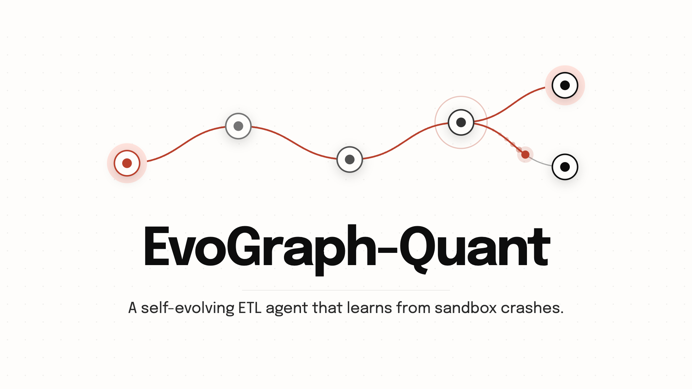 | **EvoGraph-Quant**: A self-evolving ETL agent that learns from sandbox crashes so only verified data reaches the risk graph. |
| **02 · The Problem** (`0:05`) | 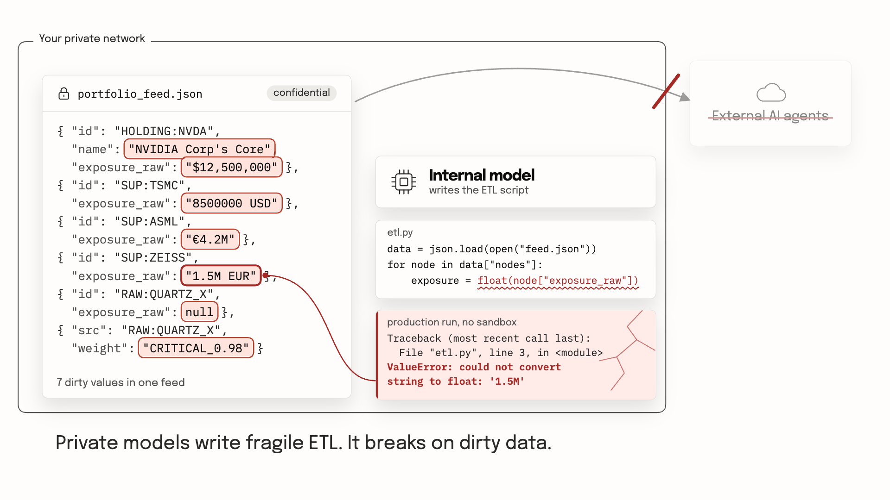 | **Confidential Data Boundary**: Positions cannot leave the private network to external cloud agents, while internal models crash on dirty fields (`'1.5M EUR'`, `null`, `'CRITICAL_0.98'`). |
| **03 · Hidden Contagion** (`0:13`) | 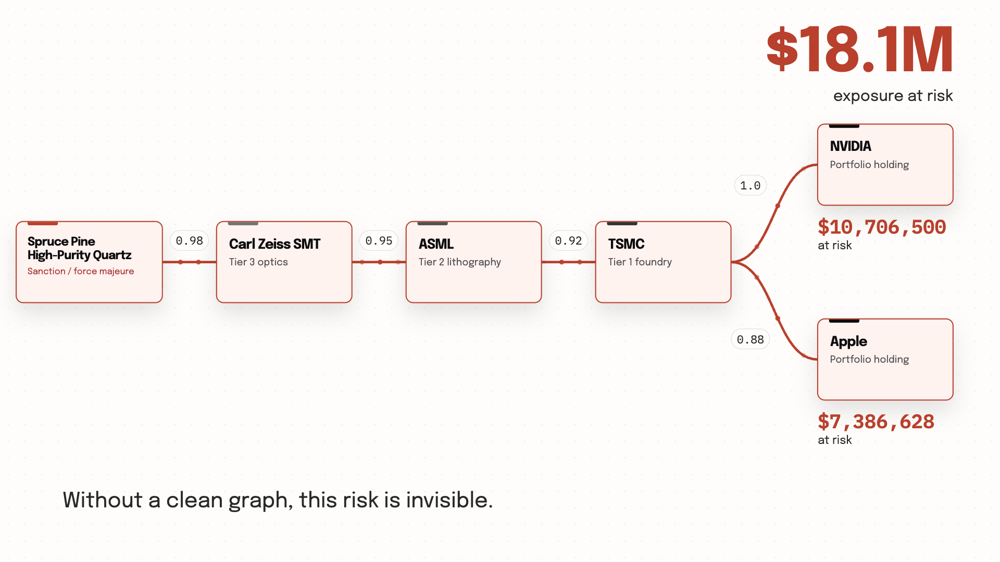 | **\$18.1M Exposure at Risk**: A single force-majeure outage at Spruce Pine high-purity quartz propagates 4 hops through Zeiss → ASML → TSMC to `NVDA` (\$10.71M) and `AAPL` (\$7.39M). |
| **04 · Evolution Loop** (`0:22`) | 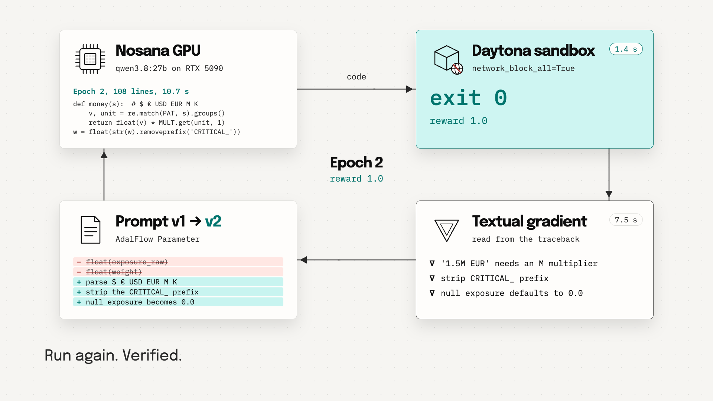 | **Sandbox as Loss Function**: Epoch 1 crashes in an offline Daytona sandbox (`exit 1`); Nosana computes a textual gradient to rewrite the AdalFlow prompt parameter (`v1 → v2`); Epoch 2 passes (`exit 0`, `reward 1.0`). |
| **05 · Ground-Truth Verifier** (`0:35`) | 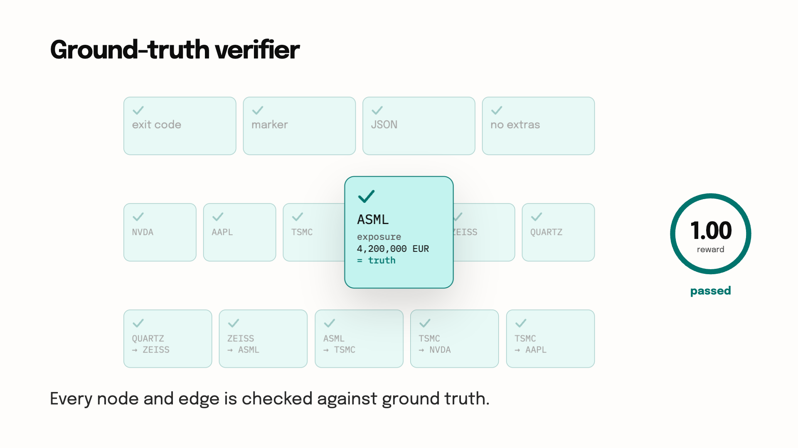 | **Anti-Reward-Hacking Gate**: Host-side checker validates 15 independent assertions (exit code, marker, JSON schema, 6 nodes, 5 edges, exact names & currencies) before granting `reward = 1.0`. |
| **06 · Neo4j Graph & Lineage** (`0:43`) | 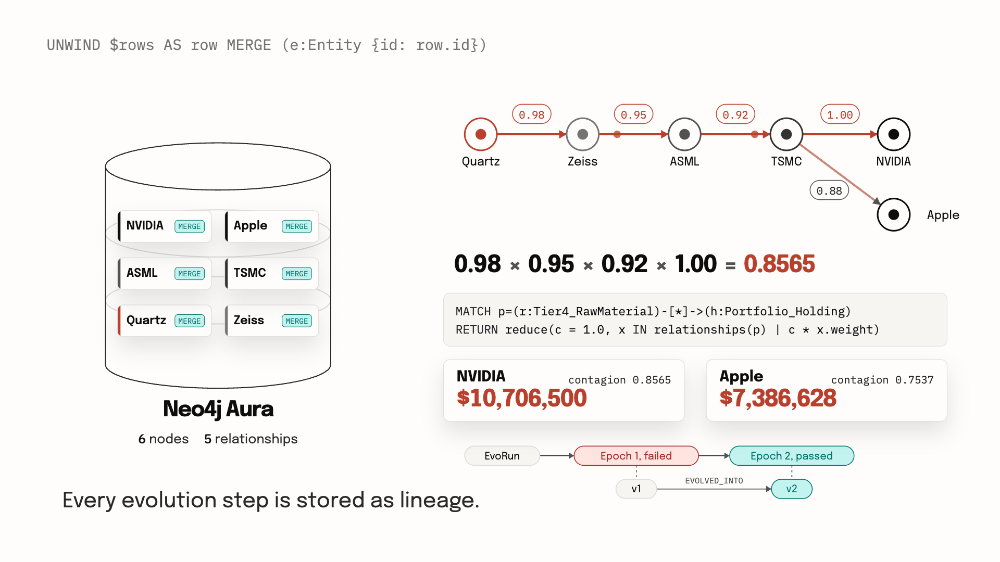 | **Verified Commit & Audit Trail**: Parameterized `UNWIND … MERGE` writes clean entities, Cypher `reduce()` computes multi-hop contagion, and `:EvoRun → :Epoch → :PromptVersion` records agent lineage. |
| **07 · Scale & Evidence** (`0:53`) | 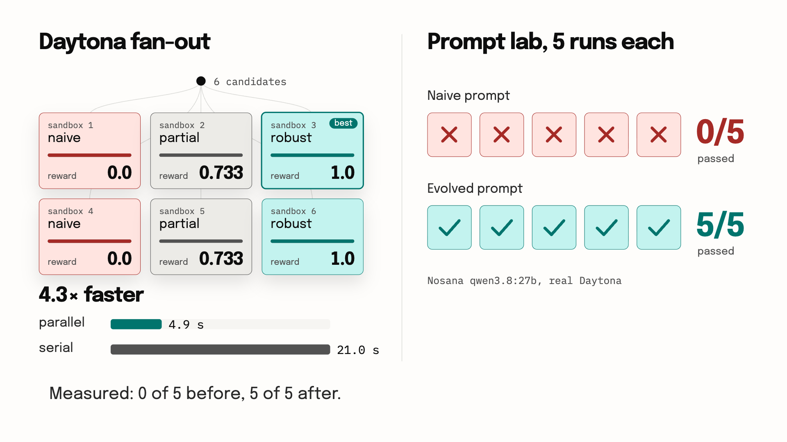 | **4.3× Parallel Fan-Out & Prompt Lab**: 6 candidate scripts verified in 6 parallel Daytona sandboxes in **4.9 s** (vs. 21.0 s serial); Prompt Lab improves pass rate from **0/5 → 5/5**. |
| **08 · Sponsor Stack** (`1:01`) | 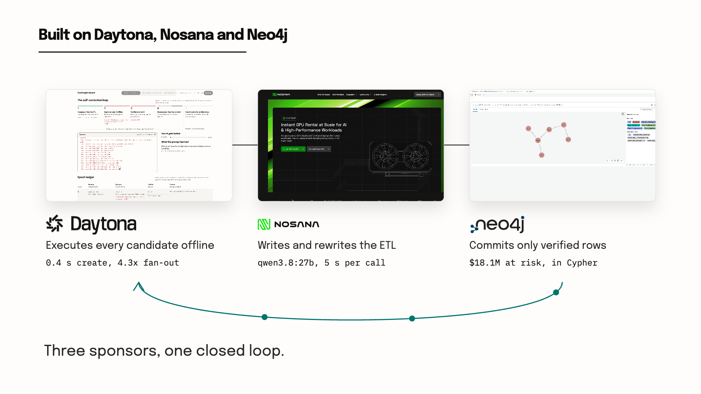 | **Three Sponsors, One Closed Loop**: **Daytona** (offline verifier) × **Nosana** (private GPU inference) × **Neo4j** (contagion graph & lineage). |
| **09 · Live Product** (`1:13`) | 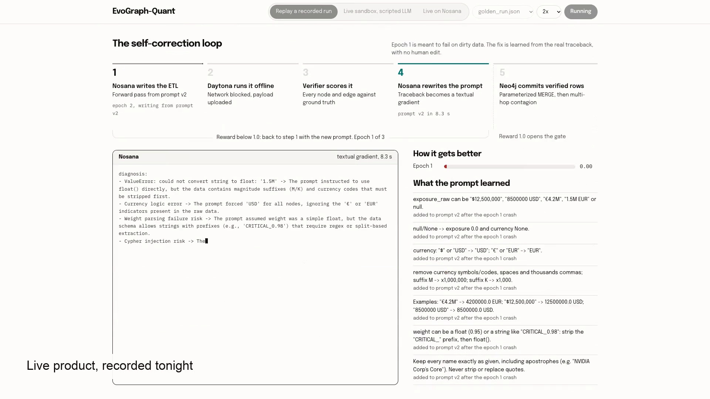 | **Real-Time Web Console (`localhost:8600`)**: Live SSE stream showing station-by-station progress, sandbox tracebacks, prompt diffs, and animated contagion graph. |
| **10 · Outro** (`1:21`) | 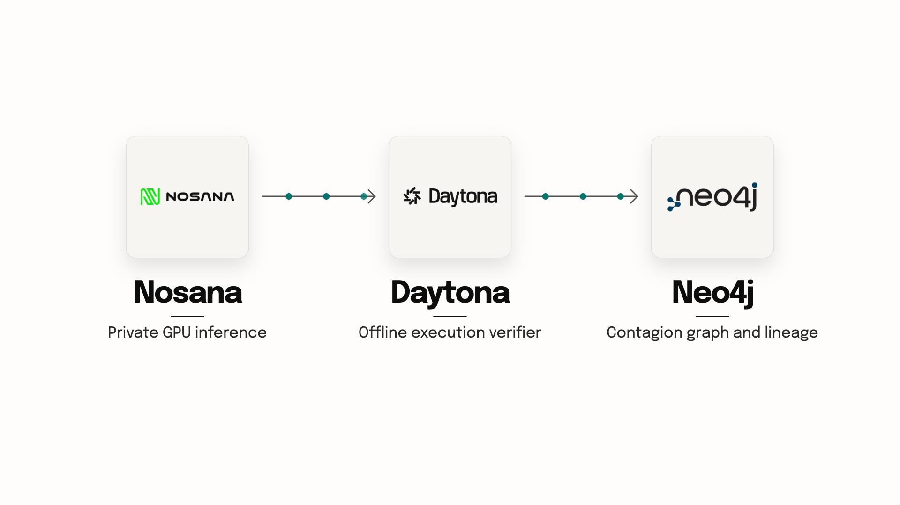 | **Zero Human Babysitting**: Failing → Diagnosing → Fixing → Verifying → Committing, end-to-end in 35 seconds. |

</details>

---

## 🎯 The Problem

Quant desks and institutional risk teams need to merge **confidential portfolio holdings** with **alternative supply-chain intelligence** into a unified knowledge graph to answer high-stakes questions:

> *"If a sole-source Tier-4 raw material suffers a sanction or force-majeure outage, which of our portfolio positions are exposed across multi-hop supplier dependencies, and how many dollars are at risk?"*

Two engineering barriers block them in production:

1. **Strict Data Confidentiality (No External Cloud Agents):** Portfolio holdings and proprietary supplier feeds cannot be sent to closed, third-party coding agents. Inference must run on private GPU compute within the firm's security boundary.
2. **Small Open Models Write Fragile ETL Code:** Real-world vendor feeds are notoriously dirty. When an internal model generates a naive ETL script, it either **crashes at runtime** or **silently corrupts numbers** in the risk graph.

### The 3 Data Traps (`dirty_payload.py`)

To test genuine self-healing rather than toy happy paths, `dirty_payload.py` embeds three realistic data traps that cause naive scripts to fail deterministically in Epoch 1:

| # | Trap Category | Raw Feed Examples | What Naive ETL Code Does | How EvoGraph-Quant Solves It |
| :-: | :--- | :--- | :--- | :--- |
| **1** | **Apostrophes & Quotes in Entity Names** | `"NVIDIA Corp's Core"`, `"Carl Zeiss SMT's Optics"`, `"Sole source for 'Ultra-Pure' crucible"` | String-interpolated Cypher (`f"CREATE ... '{name}'"`) breaks syntax or enables injection; stripping quotes fails byte-exact verification. | Enforces byte-exact name preservation in Python and commits via parameterized `UNWIND $rows AS row MERGE` in `graph_store.py`. |
| **2** | **Heterogeneous Currencies, Suffixes & Nulls** | `"$12,500,000"`, `"8500000 USD"`, `"€4.2M"`, `"1.5M EUR"`, `null` | Direct `float(node["exposure_raw"])` or partial stripping crashes with `ValueError: could not convert string to float: '1.5M'` or `TypeError`. | Learns regex currency extraction (`USD`/`EUR`), magnitude multipliers (`M` → `×1e6`, `K` → `×1e3`), and `null → 0.0` defaults from the sandbox traceback. |
| **3** | **Severity-Prefixed Edge Weights** | `"CRITICAL_0.98"`, `"CRITICAL_1.0"` mixed with numeric `0.95`, `0.92`, `0.88` | Direct `float(edge["weight"])` raises `ValueError`. | Learns prefix-stripping rules before float conversion and validates weights within `±0.005` of ground truth. |

---

## ⚙️ How It Works

<p align="center">
  <picture>
    <source media="(prefers-color-scheme: dark)" srcset="assets/architecture.svg">
    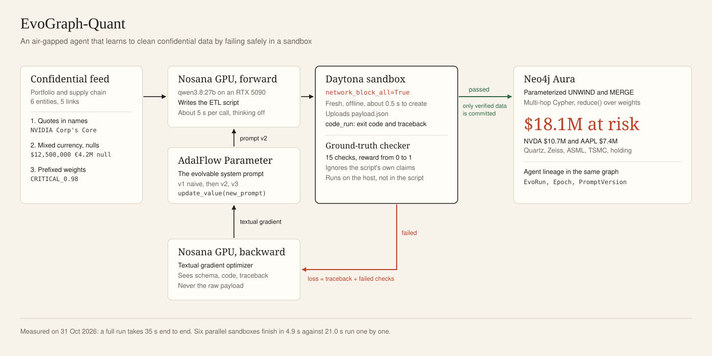
  </picture>
</p>

EvoGraph-Quant treats **an air-gapped Daytona sandbox as the reinforcement learning loss function** and **the system prompt as a trainable AdalFlow parameter**:

1. **Forward Pass (Nosana GPU):** An open-weight model (`qwen3.8:27b` on a Nosana RTX 5090, 32 GB) reads the active system prompt—wrapped as an `adalflow.optim.parameter.Parameter(requires_opt=True)`—and writes a standalone, stdlib-only Python ETL script.
2. **Air-Gapped Execution Verifier (Daytona Sandbox):** `sandbox_verifier.py` spins up an isolated Daytona sandbox with **`network_block_all=True`**. The confidential feed is uploaded directly into the sandbox filesystem as `payload.json` (`sandbox.fs.upload_file`) and never appears inside the generated code or backward prompt. `sandbox.process.code_run()` captures the real `exit_code`, `stdout`, and `stderr` traceback.
3. **Independent Ground-Truth Gate (`ground_truth_checker.py`):** A script printing `"ASSERTION_PASSED_GRAPH_COMMITTED"` earns nothing by itself. The host parses the emitted `CLEANED_GRAPH_JSON:` payload and runs **15 independent checks** against `GROUND_TRUTH`:
   - `exit_code == 0`, commit marker present, valid JSON schema, no unexpected nodes or edges
   - All **6 entities** verified: byte-exact `name` (apostrophes intact), `tier`, `status`, `currency` (`USD` / `EUR` / `None`), and numeric `exposure` within **1% relative tolerance**
   - All **5 dependency edges** verified: exact `rel` type and `weight` within **±0.005 absolute tolerance**
   - Prevents reward hacking (such as wrapping broken parsers in `try/except` and printing fake success markers).
4. **Backward Pass / Textual Gradient (Nosana + AdalFlow):** When `reward < 1.0`, the optimizer receives the failed script, the Daytona traceback, the checker's failed assertions, and a **privacy-preserving schema hint** (`get_schema_hint()`—never the raw confidential portfolio values). It outputs a structured JSON diagnosis (`textual_gradient`) and an evolved system prompt (`updated_prompt`), updating `Parameter.update_value()` in-place.
5. **Best-of-K Parallel Fan-Out (`parallel_sandbox.py`):** Because Daytona sandboxes spin up in ~0.5 s, `verify_many()` can fan out $K=6$ candidate scripts across 6 concurrent offline sandboxes (`ThreadPoolExecutor`) in **4.9 s** vs. **21.0 s** serial (**4.3× speedup**) and commit the best verified candidate.
6. **Verified Commit & Multi-Hop Contagion (Neo4j Aura):** Only when `reward == 1.0` does the host commit the cleaned graph to Neo4j via parameterized `UNWIND … MERGE`. A single variable-length Cypher query with `reduce()` computes how a Tier-4 shock propagates across tiers to portfolio holdings, while storing the agent's own evolution lineage (`:EvoRun` → `:Epoch` → `:PromptVersion`).

<p align="center">
  <picture>
    <source media="(prefers-color-scheme: dark)" srcset="assets/loop.svg">
    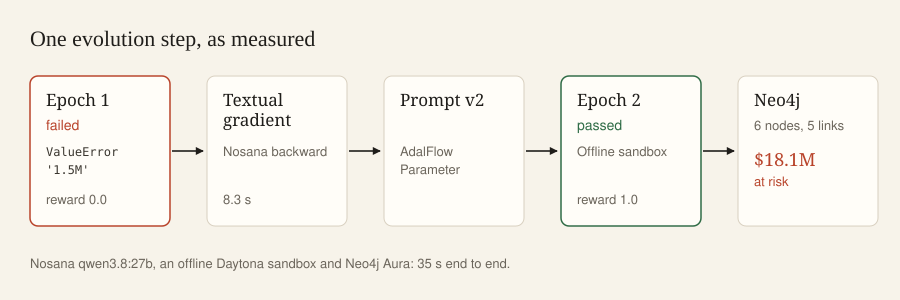
  </picture>
</p>

---

## 📊 Measured Benchmarks & Evidence

### 1. Multi-Hop Supply-Chain Contagion Result

A force-majeure outage at **`RAW:QUARTZ_X`** (*Spruce Pine High-Purity Quartz*) propagates 4 hops through **`SUP:ZEISS`** (*Carl Zeiss SMT's Optics*) → **`SUP:ASML`** (*ASML Holding N.V.*) → **`SUP:TSMC`** (*Taiwan Semi*) to hit two core portfolio holdings:

| Portfolio Holding | Contagion Path | Path Contagion ($\prod w_i$) | Total Exposure | Exposure at Risk |
| :--- | :--- | :--- | ---: | ---: |
| **`HOLDING:NVDA`** (*NVIDIA Corp's Core*) | `QUARTZ_X → ZEISS → ASML → TSMC → NVDA` | $0.98 \times 0.95 \times 0.92 \times 1.00 =$ **`0.8565`** | \$12,500,000 | **\$10,706,500** |
| **`HOLDING:AAPL`** (*Apple Inc.*) | `QUARTZ_X → ZEISS → ASML → TSMC → AAPL` | $0.98 \times 0.95 \times 0.92 \times 0.88 =$ **`0.7537`** | \$9,800,000 | **\$7,386,628** |
| **Total Portfolio At Risk** | — | — | **\$22,300,000** | **\$18,093,128 (≈ \$18.1M)** |

### 2. System Performance & Verification Benchmarks

All benchmarks below are reproducible and backed by committed artifacts (`replay/golden_run.json`, `docs/PROMPT_LAB.md`, `docs/prompt_lab_results.json`, and `docs/GENERALIZATION.md`):

| Benchmark | Stack / Configuration | Key Result | Evidence / Artifact |
| :--- | :--- | :--- | :--- |
| **End-to-End Golden Run** | Live **Nosana** (`qwen3.8:27b` on RTX 5090) + offline **Daytona** + **Neo4j Aura** | **35.0 s** total. Warm-up `2.2 s` → Epoch 1 forward `4.8 s` + sandbox `2.5 s` (`exit 1`, `ValueError: '1.5M'`, `reward 0.0`) → Textual gradient `8.3 s` → Epoch 2 forward `10.7 s` + sandbox `1.6 s` (`exit 0`, `reward 1.0`) → Neo4j commit `0.9 s` (6 nodes, 5 edges). | [`replay/golden_run.json`](replay/golden_run.json) |
| **Prompt Lab Determinism** | 5 live runs per prompt on **Nosana** `qwen3.8:27b` + real offline **Daytona** | `NAIVE_INITIAL_PROMPT`: **0 / 5 passed** (avg reward `0.00`; all 5 crash on `'1.5M'`). After **1 live backward pass** (`8.9 s`), the evolved prompt achieves **5 / 5 passed** (avg reward `1.00`). | [`docs/PROMPT_LAB.md`](docs/PROMPT_LAB.md), [`docs/prompt_lab_results.json`](docs/prompt_lab_results.json) |
| **Daytona Parallel Fan-Out** | 6 candidate scripts (`naive`, `partial`, `robust` × 2) in 6 concurrent offline sandboxes | **4.9 s** wall time in parallel vs. **21.0 s** serial (**4.3× speedup**). Selects `robust` winner (`reward 1.0`). | [`parallel_sandbox.py`](parallel_sandbox.py), [`scripts/demo_parallel.py`](scripts/demo_parallel.py) |
| **Scripted 3-Epoch Progression** | Real offline **Daytona** + **Neo4j**, pre-authored LLM steps (`naive → partial → robust`) | Reward progresses **0.000 → 0.733 → 1.000** across 3 epochs (`partial_etl.py` misses the `M` multiplier on `ASML`/`ZEISS`; checker catches it with partial credit `11/15`). | [`replay/scripted_run.json`](replay/scripted_run.json), [`scripts/e2e_scripted.py`](scripts/e2e_scripted.py) |
| **Unseen Feed Generalization** | Epoch-3 winner tested on unseen 15-node / 18-edge EV-battery chain (`data/scenario_ev_battery.json`) | Unchanged script crashes on unseen `"HIGH_0.8"` weight prefix (`reward 0.0`). Adding **1 generalized prefix rule** lifts score to **0.946** (`35/37` checks passed; only `¥ → JPY` remains for the next epoch). | [`docs/GENERALIZATION.md`](docs/GENERALIZATION.md), [`scripts/generalize.py`](scripts/generalize.py) |

---

## 🧩 Sponsor Integration Depth

Each sponsor occupies a non-removable station in the closed learning loop. Full file-and-line API references are documented in [`docs/SPONSORS.md`](docs/SPONSORS.md).

```text
 Nosana GPU (forward codegen) ──► Daytona Offline Sandbox (execute = loss) ──► Ground-Truth Checker (15 checks)
        ▲                                                                                   │
        │                    Nosana GPU (backward textual gradient) ◄───────────────────────┼── (if reward < 1.0)
        │                                                                                   │
        └─────────────── Neo4j Aura (parameterized MERGE + contagion + lineage) ◄───────────┘   (only when reward == 1.0)
```

### 1. Daytona — Air-Gapped Execution Verifier (RL Loss Environment)
- **Offline Isolation (`network_block_all=True`):** Created via `Daytona(DaytonaConfig(...)).create(CreateSandboxFromSnapshotParams(language="python", network_block_all=True))` in ~0.5 s. Inside the sandbox, outbound DNS to Aura (`:7687`) and `pypi.org` fails completely—LLM-generated code physically cannot exfiltrate confidential data.
- **Out-of-Prompt Payload Injection:** Raw portfolio JSON is uploaded via `sandbox.fs.upload_file(payload_bytes, "payload.json")` (`sandbox_verifier.py`), keeping confidential values out of code strings and backward prompts.
- **Runtime Signal as Loss:** `sandbox.process.code_run(code)` captures real `exit_code` and `result` (stderr tracebacks) to drive prompt optimization.
- **Parallel Best-of-K Search:** `parallel_sandbox.py` fans out $K$ candidate scripts across $K$ isolated sandboxes in parallel (`4.9 s` for 6 sandboxes vs. `21.0 s` serial).
- **Honest Local Fallback:** When `DAYTONA_API_KEY` is omitted or `USE_LOCAL_FALLBACK=true`, execution degrades gracefully to an isolated local subprocess and the UI explicitly labels the engine **`Local Fallback (subprocess)`**.

### 2. Nosana — Private Open-Weight GPU Inference
- **Policy & Optimizer on Private Compute:** Both the forward pass (code generation, ~5.4 s) and backward pass (JSON textual gradient & prompt rewrite, ~5.1 s) run on **`qwen3.8:27b` served via Ollama on a Nosana RTX 5090 (32 GB)**, with thinking disabled (`/no_think` and `<think>` stripping handled automatically in `llm_client.py`).
- **OpenAI-Compatible Client & Honest Labeling:** `llm_client.py` connects to `LLM_BASE_URL` and surfaces exact provider metadata (`Nosana (RTX 5090 · qwen3.8:27b)`) to the UI and event stream. If the primary endpoint is unreachable, it can switch to `FALLBACK_BASE_URL` or `OPENAI_API_KEY` and clearly labels the run as a fallback endpoint.

### 3. Neo4j — Verified Contagion Graph & Evolution Lineage
- **Injection-Safe Parameterized Upserts:** `graph_store.py` commits verified entities and edges exclusively from the host via parameterized `UNWIND $rows AS row MERGE (n:Entity {id: row.id}) SET n += row` and a strict tier/relationship-type whitelist, neutralizing the apostrophe trap (`NVIDIA Corp's Core`).
- **Single-Query Multi-Hop Contagion:**
  ```cypher
  MATCH p = (r:Entity {tier: 'Tier4_RawMaterial'})-[*1..6]->(h:Entity {tier: 'Portfolio_Holding'})
  WITH p, h, reduce(s = 1.0, x IN relationships(p) | s * x.weight) AS contagion
  RETURN [n IN nodes(p) | n.id] AS path, h.id AS holding, contagion, h.exposure * contagion AS at_risk
  ORDER BY at_risk DESC
  ```
- **Queryable Agent Lineage & GraphRAG Memory:** Every run, epoch, and prompt evolution step is persisted in the same graph (`(:EvoRun)-[:HAS_EPOCH]->(:Epoch)-[:USED_PROMPT]->(:PromptVersion)-[:EVOLVED_INTO {via_gradient}]->(:PromptVersion)`), providing compliance teams with a full audit trail of which prompt version produced which graph state. Ready-to-run console queries and browser styling are in [`queries.cypher`](queries.cypher), [`assets/neo4j_style.grass`](assets/neo4j_style.grass), and [`docs/NEO4J_DEMO.md`](docs/NEO4J_DEMO.md).

---

## ⚡ Quick Start

> 🤖 **For AI Coding Agents or fresh machines:** See [`AGENTS.md`](AGENTS.md) for a complete, step-by-step verification guide (both zero-credential and full live stack).

### 0. Installation

```bash
git clone git@github.com:CookieLau/EvoGraph-Agent.git
cd EvoGraph-Agent
./setup.sh                  # Creates .venv (Python 3.10+ recommended; 3.9 supported), installs deps, copies .env.example -> .env
source .venv/bin/activate
```

### Path A: Zero-Credential Mode (Runs in < 1 Minute)

With **no API keys** in `.env`, every component degrades cleanly to a labeled local mode (`Local Fallback` subprocess, pre-authored scripted LLM progression, and local in-memory contagion calculation):

```bash
# 1. Run the 15-check ground-truth verifier unit test suite (9 tests)
python -m pytest tests/test_checker.py -q

# 2. Smoke-test the sandbox verifier (naive script exits 1 -> robust script scores 1.00)
python scripts/smoke_daytona.py

# 3. Run the 3-epoch self-healing progression (reward: 0.0 -> 0.733 -> 1.0, NVDA $10.71M & AAPL $7.39M at risk)
python scripts/e2e_scripted.py --no-neo4j --no-save

# 4. Run 6-candidate parallel fan-out
python scripts/demo_parallel.py

# 5. Launch the Web Console at http://localhost:8600 (stdlib server, zero extra dependencies)
python web_server.py
```

### Path B: Full Live Stack (Daytona + Nosana / OpenAI / Ollama + Neo4j Aura)

Configure `.env` with your credentials (leave unused keys empty rather than keeping placeholder text):

```ini
# 1. Daytona Sandbox Verifier
DAYTONA_API_KEY="dtn_..."
DAYTONA_API_URL="https://app.daytona.io/api"
USE_LOCAL_FALLBACK="false"

# 2. LLM Endpoint (Nosana Ollama/vLLM job, local Ollama, or OpenAI-compatible API)
LLM_BASE_URL="http://127.0.0.1:11435/v1"     # Or your Nosana endpoint / https://api.openai.com/v1
LLM_API_KEY="ollama"                         # Or your sk-... key
FORWARD_MODEL="qwen3.8:27b"                  # Or gpt-4o-mini / qwen2.5-coder:7b
BACKWARD_MODEL="qwen3.8:27b"                 # Or gpt-4o

# 3. Neo4j AuraDB / Local Instance
NEO4J_URI="neo4j+s://xxxx.databases.neo4j.io"
NEO4J_USER="neo4j"
NEO4J_PASSWORD="your_password"
NEO4J_DATABASE="neo4j"
```

Verify each service independently and run the live evolution loop:

```bash
# Independent service smoke tests
python scripts/smoke_daytona.py              # Confirms "Daytona Sandbox (xxxxxxxx) · offline"
python scripts/smoke_llm.py                  # Confirms /v1 health, model list, and completion
python scripts/smoke_neo4j.py                # Confirms Aura connectivity, MERGE upsert, and Cypher contagion

# Run live evolution loop from CLI (and optionally record a replay artifact)
python orchestrator.py --epochs 3 --record replay/my_live_run.json

# Test generalization on the unseen 15-node EV-battery supply chain in a real Daytona sandbox
python scripts/generalize.py

# Start the Web Console (http://localhost:8600)
python web_server.py
```

---

## 🖥️ Web Console & Run Modes

<p align="center">
  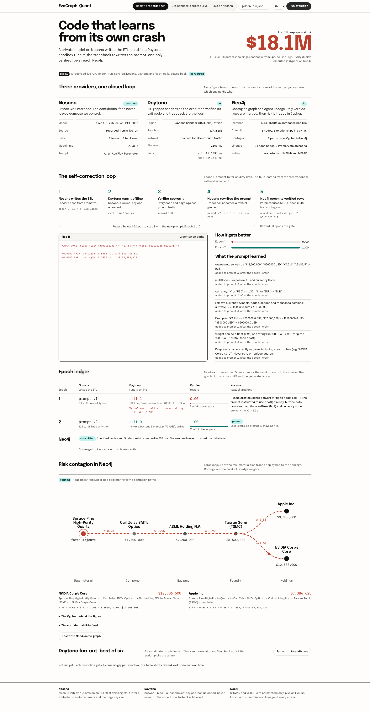
</p>

The web console (`python web_server.py` → `http://localhost:8600`, built on `web/index.html` and stdlib `ThreadingHTTPServer`) provides three transparent run modes in the top control bar:

| Mode | LLM Forward & Backward | Daytona Sandbox | Neo4j Graph & Contagion | Best For |
| :--- | :--- | :--- | :--- | :--- |
| **Replay a recorded run** | Replays recorded events (`golden_run.json`, `scripted_run.json`, `mock_run.json`) | Recorded real Daytona run (`golden_run.json` & `scripted_run.json`) | Recorded real Aura commit & contagion | Instant walkthroughs, offline stage backup |
| **Live sandbox, scripted LLM** | Pre-authored `reference/` scripts & gradients (`0.0 → 0.733 → 1.0`) | **Live**, offline (`network_block_all=True`) or labeled Local Fallback | **Live** parameterized `MERGE` & Cypher `reduce()` (or labeled local fallback) | Testing Daytona & Neo4j live without waiting on LLM tokens |
| **Live on Nosana** | **Live** calls to `qwen3.8:27b` on Nosana (or configured OpenAI-compatible endpoint) | **Live**, offline (`network_block_all=True`) | **Live** parameterized `MERGE`, Cypher `reduce()`, and `:EvoRun` lineage | Full end-to-end autonomous self-evolution (~35 s) |

### Headless HTTP & SSE API (`web_server.py`)

External tools and agents can drive the server directly via HTTP and Server-Sent Events (SSE):

```bash
curl -s http://localhost:8600/api/config                          # Active provider status (never exposes secrets)
curl -s http://localhost:8600/api/replays                         # Available replay files (golden_run.json first)
curl -sN "http://localhost:8600/api/run?mode=scripted&epochs=3"   # Stream live SSE evolution events
curl -sN "http://localhost:8600/api/run?mode=live&epochs=3"       # Stream full live LLM + Daytona + Neo4j run
curl -s -X POST http://localhost:8600/api/fanout                  # Trigger best-of-6 parallel sandbox fan-out
curl -s -X POST http://localhost:8600/api/reset                   # Reset Neo4j demo entity nodes
```

*(Note: The legacy Streamlit dashboard remains available via `streamlit run app.py` on port `8501`.)*

---

## 📜 Sandbox Script Contract

Every LLM-generated Python script executed inside the Daytona sandbox must adhere to a strict, verifiable contract:

1. **Offline & Stdlib-Only:** Read `payload.json` from the current working directory using only Python standard library modules (`json`, `re`, `math`), with zero outbound network access (`network_block_all=True`).
2. **Structured Graph Emission:** Print a single line prefixed with `CLEANED_GRAPH_JSON:` containing normalized `nodes` (`id`, `name`, `tier`, `exposure`, `currency`, `status`) and `edges` (`src`, `dst`, `rel`, `weight`).
3. **Explicit Completion Marker:** Print `ASSERTION_PASSED_GRAPH_COMMITTED` as its final line and exit with code `0` (any unhandled exception exits non-zero).
4. **Host-Side Ground-Truth Verification:** Even if `exit_code == 0` and the marker is printed, `ground_truth_checker.py` independently validates all 15 node, edge, currency, and tolerance checks before granting `reward = 1.0`.

---

## 📁 Project Structure

```text
EvoGraph-Agent/
├── README.md                  # Project overview, launch video, architecture, benchmarks & quickstart
├── AGENTS.md                  # Zero-to-running verification guide for AI agents & fresh machines
├── CONTRACT.md                # Shared module interfaces, ground-truth specification & SSE event schema
├── setup.sh                   # Automated virtualenv setup & dependency installer
├── requirements.txt           # Core Python dependencies (daytona, adalflow, neo4j, openai, pydantic, etc.)
├── requirements.lock.txt      # Pinned lockfile
│
├── dirty_payload.py           # Confidential portfolio/supply-chain feed with 3 data traps & GROUND_TRUTH
├── ground_truth_checker.py    # 15-check host-side reward verifier (anti-reward-hacking gate)
├── sandbox_verifier.py        # Daytona offline sandbox wrapper (warmup, upload_file, code_run) + local fallback
├── parallel_sandbox.py        # Daytona best-of-K parallel sandbox fan-out (ThreadPoolExecutor)
├── llm_client.py              # OpenAI-compatible LLM client for Nosana (with qwen3 /no_think & fallback support)
├── prompts.py                 # Deliberately naive initial prompt, forward/backward templates & reference prompt
├── evo_engine.py              # AdalFlow Parameter wrapper, forward codegen & backward textual-gradient engine
├── graph_store.py             # Neo4j Aura store: parameterized UNWIND MERGE, Cypher contagion & agent lineage
├── orchestrator.py            # Event-stream evolution loop, CLI runner & replay recorder/loader
├── queries.cypher             # Ready-to-run Neo4j Browser / Aura Cypher queries (contagion, what-if, lineage)
│
├── web_server.py              # Zero-dependency stdlib HTTP + SSE server (http://localhost:8600)
├── web/index.html             # Editorial web console: provider strip, 5-station loop, diffs, Neo4j graph & fan-out
├── app.py                     # Legacy Streamlit dashboard (http://localhost:8501)
├── brand/tokens.css           # Shared design tokens across web console, slide deck, and launch video
│
├── video/                     # 88s Launch Film & programmatic video pipeline
│   ├── EvoGraph-Quant_launch.mp4       # 1080p master launch video (30 fps)
│   ├── EvoGraph-Quant_launch_720p.mp4  # 720p streaming launch video
│   ├── launch_preview.gif              # Palette-optimized inline animated preview for GitHub README
│   ├── index.html                      # Standalone interactive chapter video player
│   ├── scenes/                         # 10 HTML scene sources rendered via headless Chrome (capture.mjs)
│   ├── stills/                         # High-res 1080p keyframes (s01..s08, real_app, contact_sheet.png)
│   └── assemble.sh                     # FFmpeg cross-fade assembly, poster & player generator
│
├── slides/                    # 17-slide pitch deck
│   ├── EvoGraph-Quant.pdf              # Exported PDF slide deck
│   └── index.html                      # Interactive HTML/CSS slide deck with keyboard navigation
│
├── docs/                      # Deep-dive documentation & empirical results
│   ├── PITCH.md                        # 3-minute stage demo script, timing beats & Q&A handbook
│   ├── SPONSORS.md                     # API-level integration scorecard for Daytona, Nosana & Neo4j
│   ├── PROMPT_LAB.md                   # 0/5 -> 5/5 determinism benchmark on Nosana + Daytona
│   ├── prompt_lab_results.json         # Raw outputs, timings, and evolved prompts from Prompt Lab
│   ├── GENERALIZATION.md               # Out-of-distribution test on unseen EV-battery supply chain
│   └── NEO4J_DEMO.md                   # Neo4j Aura console demo guide & Cypher walkthrough
│
├── data/                      # Unseen dirty supply-chain scenarios for generalization testing
│   ├── scenario_ev_battery.json        # 15-node / 18-edge EV-battery feed with new dirt patterns
│   └── scenario_ev_battery_truth.json  # Ground truth for EV-battery generalization benchmark
│
├── reference/                 # Hand-authored naive (0.0), partial (0.733), and robust (1.0) ETL scripts
├── replay/                    # Recorded event streams: golden_run.json (live stack), scripted_run.json, mock_run.json
├── scripts/                   # Smoke tests (smoke_*.py), e2e_scripted.py, demo_parallel.py, generalize.py
├── tests/test_checker.py      # Unit tests for ground_truth_checker.py
└── assets/                    # Diagrams (dark/light SVG), UI screenshots (assets/screens/), sponsor logos & GraSS style
```
